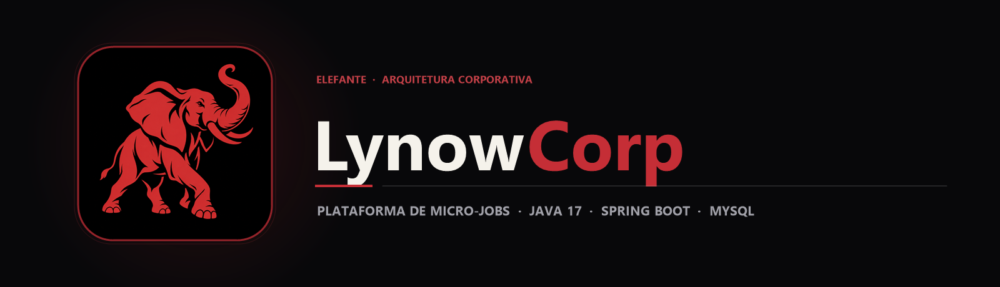

  

  Plataforma back-end para intermediação de micro-jobs construída com Java 17, Spring Boot, Spring Data JPA e MySQL.

  
  
  

## Sobre o projeto

O mercado de serviços rápidos (*micro-jobs*) sofre com a fricção entre clientes que precisam resolver demandas pontuais e profissionais autônomos em busca de oportunidades imediatas. A **Lynow Corp Platform** nasceu para conectar essas duas pontas por meio de uma API RESTful sólida e escalável.

Estruturado como um monorepo, o projeto reúne a modelagem relacional em **MySQL** (usuários, oportunidades e chaves estrangeiras) e o motor back-end em **Java 17 com Spring Boot**, aplicando arquitetura em camadas (Controller, Model e Repository) e persistência automatizada via **Spring Data JPA / Hibernate**.

## Principais recursos

| Recurso | Como funciona |
|---|---|
| API RESTful de Usuários | UsuarioController expõe endpoints HTTP (GET /usuarios e POST /usuarios) com serialização JSON automática. |
| Mapeamento ORM com JPA | A entidade Usuario mapeia colunas, tipos e restrições diretamente para o schema relacional do MySQL. |
| Repositório Desacoplado | UsuarioRepository estende JpaRepository, fornecendo operações CRUD transacionais sem SQL boilerplate. |
| Endpoint de Diagnóstico | RecepcaoController oferece verificação rápida de disponibilidade e resposta da API. |
| Monorepo Banco + API | Scripts SQL de criação de tabelas e carga inicial ficam versionados ao lado da aplicação Spring Boot. |

## Tecnologias

  
  
  
  
  

- **Java 17 & Spring Boot** para construção do servidor web embutido e injeção de dependências;
- **Spring Data JPA / Hibernate** para persistência objeto-relacional;
- **MySQL** como banco de dados relacional na porta 3306;
- **Maven Wrapper (mvnw / mvnw.cmd)** para build reproduzível sem exigir instalação global do Maven.

## Arquitetura

`mermaid
flowchart LR
    A[Cliente HTTP / Postman] -->|GET / POST JSON| B[UsuarioController]
    B --> C[UsuarioRepository · Spring Data JPA]
    C --> D[Hibernate ORM]
    D --> E[(MySQL · lynow_db)]
`

## Estrutura do repositório

`	ext
lynow-corp-platform/
├── assets/
│   ├── banner.png                                  Banner principal LynowCorp
│   └── project-animal.png                          Símbolo do elefante
├── lynow-api/
│   └── Backend-api/
│       ├── src/main/java/com/lynow/lynow_api/
│       │   ├── controller/UsuarioController.java   Endpoints REST de usuários
│       │   ├── model/Usuario.java                  Entidade JPA mapeada
│       │   ├── repository/UsuarioRepository.java   Interface JpaRepository
│       │   ├── RecepcaoController.java             Rota de boas-vindas / healthcheck
│       │   └── LynowApiApplication.java            Ponto de entrada Spring Boot
│       ├── src/main/resources/
│       │   └── application.properties              Configuração de DataSource MySQL
│       └── pom.xml                                 Dependências Maven do projeto
└── README.md
`

## Executando o código

1. Clone o repositório:
   `ash
   git clone https://github.com/arthurlynow098/lynow-corp-platform.git
   cd lynow-corp-platform/lynow-api/Backend-api
   `
2. Certifique-se de ter um servidor **MySQL** ativo com o schema lynow_db criado e configure seu usuário e senha em src/main/resources/application.properties:
   `properties
   spring.datasource.username=seu_usuario
   spring.datasource.password=sua_senha
   `
3. Inicie a API com o Maven Wrapper:
   `powershell
   .\mvnw.cmd spring-boot:run
   `
4. Teste os endpoints em http://localhost:8080/usuarios via Postman, Insomnia ou curl.

## Decisões técnicas

- **Padrão Repository com Spring Data JPA:** reduz drasticamente o código repetitivo de acesso a dados e garante transações seguras.
- **Separação em camadas (controller, model, 
epository):** prepara o terreno para a inclusão de regras de negócio e autenticação JWT na camada de serviço.

---

Estudo · construção · evolução <a href="https://github.com/arthurlynow098">Perfil</a> · <a href="https://arthurentsev.vercel.app/">Portfólio</a> · <a href="https://www.linkedin.com/in/entsevarthur/">LinkedIn</a>

