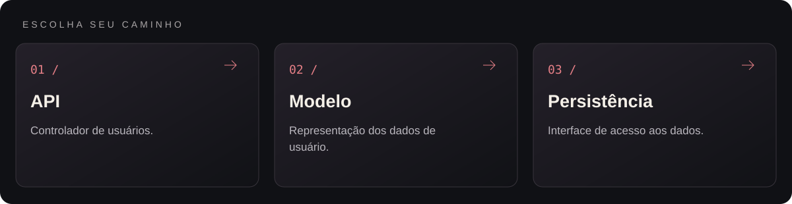
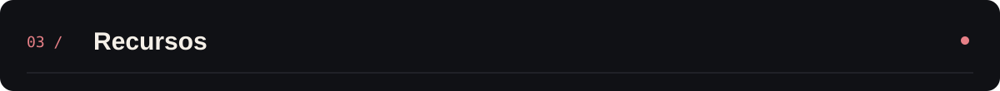
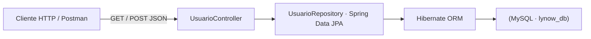
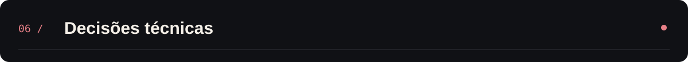

<p align="center">
  
</p>

<p align="center">Back-end para conectar clientes e profissionais em serviços pontuais.</p>

<p align="center"></p>

<p align="center"><a href="#visão-geral">Visão geral</a> &nbsp;·&nbsp; <a href="#recursos">Recursos</a> &nbsp;·&nbsp; <a href="#como-executar">Como executar</a></p>

---

<a id="explore-o-projeto"></a>




<table width="100%">
<tr><th align="left">Área</th><th align="left">O que você encontra</th><th align="left">Acesso direto</th></tr>
<tr><td><strong>API</strong></td><td>Controlador de usuários.</td><td><a href="lynow-api/Backend-api/src/main/java/com/lynow/lynow_api/controller/UsuarioController.java">Abrir api →</a></td></tr>
<tr><td><strong>Modelo</strong></td><td>Representação dos dados de usuário.</td><td><a href="lynow-api/Backend-api/src/main/java/com/lynow/lynow_api/model/Usuario.java">Abrir modelo →</a></td></tr>
<tr><td><strong>Persistência</strong></td><td>Interface de acesso aos dados.</td><td><a href="lynow-api/Backend-api/src/main/java/com/lynow/lynow_api/repository/UsuarioRepository.java">Abrir persistência →</a></td></tr>
</table>

<a id="visão-geral"></a>


Estruturado como um monorepo, o projeto reúne a modelagem relacional em **MySQL** (usuários, oportunidades e chaves estrangeiras) e o motor back-end em **Java 17 com Spring Boot**, aplicando arquitetura em camadas (Controller, Model e Repository) e persistência automatizada via **Spring Data JPA / Hibernate**.

<a id="recursos"></a>



| Recurso | Como funciona |
|---|---|
| API RESTful de Usuários | UsuarioController expõe endpoints HTTP (GET /usuarios e POST /usuarios) com serialização JSON automática. |
| Mapeamento ORM com JPA | A entidade Usuario mapeia colunas, tipos e restrições diretamente para o schema relacional do MySQL. |
| Repositório Desacoplado | UsuarioRepository estende JpaRepository, fornecendo operações CRUD transacionais sem SQL boilerplate. |
| Endpoint de Diagnóstico | RecepcaoController oferece verificação rápida de disponibilidade e resposta da API. |
| Monorepo Banco + API | Scripts SQL de criação de tabelas e carga inicial ficam versionados ao lado da aplicação Spring Boot. |

<a id="tecnologias"></a>


- **Java 17 & Spring Boot** para construção do servidor web embutido e injeção de dependências;
- **Spring Data JPA / Hibernate** para persistência objeto-relacional;
- **MySQL** como banco de dados relacional na porta 3306;
- **Maven Wrapper (mvnw / mvnw.cmd)** para build reproduzível sem exigir instalação global do Maven.

<details>
<summary>Arquitetura</summary>



</details>

<details>
<summary>Estrutura do repositório</summary>

```text
lynow-corp-platform/
├── assets/
│   └── banner-v2.png               Banner do projeto
├── lynow-api/
│   └── Backend-api/
│       ├── src/main/java/com/lynow/lynow_api/
│       │   ├── controller/UsuarioController.java   Endpoints REST de usuários
│       │   ├── model/Usuario.java                  Entidade JPA mapeada
│       │   ├── repository/UsuarioRepository.java   Interface JpaRepository
│       │   ├── RecepcaoController.java             Rota de boas-vindas / healthcheck
│       │   └── LynowApiApplication.java            Ponto de entrada Spring Boot
│       ├── src/main/resources/
│       │   └── application.properties              Configuração de DataSource MySQL
│       └── pom.xml                                 Dependências Maven do projeto
└── README.md
```

</details>

<a id="como-executar"></a>


1. Clone o repositório:
   ```bash
   git clone https://github.com/arthurlynow098/lynow-corp-platform.git
   cd lynow-corp-platform/lynow-api/Backend-api
   ```
2. Certifique-se de ter um servidor **MySQL** ativo com o schema lynow_db criado e configure seu usuário e senha em src/main/resources/application.properties:
   ```properties
   spring.datasource.username=seu_usuario
   spring.datasource.password=sua_senha
   ```
3. Inicie a API com o Maven Wrapper:
   ```powershell
   .\mvnw.cmd spring-boot:run
   ```
4. Teste os endpoints em http://localhost:8080/usuarios via Postman, Insomnia ou curl.

<a id="decisões-técnicas"></a>



- **Padrão Repository com Spring Data JPA:** reduz drasticamente o código repetitivo de acesso a dados e garante transações seguras.
- **Separação em camadas (controller, model, repository):** prepara o terreno para a inclusão de regras de negócio e autenticação JWT na camada de serviço.

---

<p align="center">
  <a href="https://github.com/arthurlynow098">GitHub</a> &nbsp;·&nbsp;
  <a href="https://arthurentsev.vercel.app/">Portfólio</a> &nbsp;·&nbsp;
  <a href="https://www.linkedin.com/in/entsevarthur/">LinkedIn</a>
</p>
